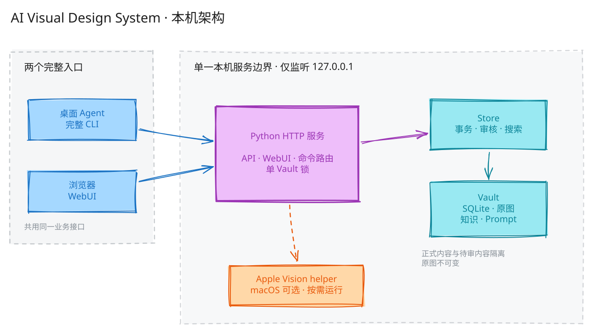

# AI Visual Design System

AI Visual Design System（AVDS）是一套在本机运行的视觉素材、知识与 Prompt 资料库。它通过一个 Python HTTP 服务，同时向桌面 Agent 和浏览器 WebUI 提供导入、提案、审核、检索与预览能力。

当前源码版本为 **1.0.0**，接口契约版本为 **1.0**。macOS 自动化回归、安装流程和 Apple Vision 已验证；Windows 10/11 实机与浏览器人工体验仍待验收。

## 架构



Agent 与 WebUI 是两个完整入口，共用同一套本机业务接口。服务统一处理审核、事务和搜索，数据保存在用户选择的 Vault；macOS 可按需使用 Apple Vision helper，Windows 不使用 Apple Vision。

架构图由 Excalidraw 绘制，可编辑源文件见 [`docs/diagrams/architecture.excalidraw`](docs/diagrams/architecture.excalidraw)。完整边界与数据流见[架构文档](docs/ARCHITECTURE.md)。

## 包含什么

- 本机 Python HTTP 服务、JSON API 与浏览器 WebUI。
- 面向用户的精简 `avds` 命令，以及项目内完整 Agent CLI。
- 图片导入、持久稍后、版本化提案、逐项审核和正式检索。
- 版本化知识 Markdown、Prompt JSON 与确定性模板渲染。
- SQLite/Vault 数据层、幂等操作、中断恢复和正式/待审内容隔离。
- macOS Apple Vision 相似度排序能力；Windows PNG/JPEG 原生适配。

项目不提供账号、云部署、数据同步、多人协作或付费模型 API。真实 Vault、用户配置和素材不会进入源码仓库。

## 安装

1. 确保本机已安装 Git，然后从 GitHub 克隆项目并进入目录：

   ```sh
   git clone https://github.com/Scrooge6792/AI-Visual-Design-System.git
   cd AI-Visual-Design-System
   ```

2. 安装 Python 3.11 或更新稳定版，并确保 Python 自带的 SQLite 支持 FTS5。Windows 建议安装包含 `py` 启动器的官方 Python；macOS 如需 Apple Vision，还需要 Xcode Command Line Tools。

3. 将下面的 Prompt 直接复制给 Agent。Agent 会先阅读项目约束和[完整安装手册](INSTALL.md)，再根据当前操作系统安装：

   ```text
   请帮我安装 AI Visual Design System。源码仓库是 https://github.com/Scrooge6792/AI-Visual-Design-System 。如果当前还没有源码，请先克隆到当前工作目录下的 AI-Visual-Design-System；如果目录已经存在，不要覆盖，先确认它是正确的项目。

   进入项目后，先完整阅读 AGENTS.md 和 INSTALL.md，再按当前操作系统执行安装。只允许写入项目目录、用户明确选择的配置位置和临时测试 Vault；不要更新旧版安装、迁移真实 Vault、覆盖已有同名命令或修改系统级 PATH。完成项目内安装以及版本、doctor、启动和状态检查后，向我报告结果，并询问我是否需要配置全局 avds 命令。未经我明确同意，不要配置全局命令或修改用户 PATH。
   ```

4. 如果选择手动安装，按照 [`INSTALL.md`](INSTALL.md) 的 macOS 或 Windows 步骤执行。安装脚本只在项目内创建 `.venv` 和可重建的 `.build`，不会注册系统服务。

5. 安装完成后选择一个**位于项目目录之外**的新 Vault，然后启动服务。macOS：

   ```sh
   ./avds config set vault "$HOME/Pictures/MyVisualVault"
   ./bin/avds doctor
   ./avds serve --open
   ```

   Windows PowerShell：

   ```powershell
   .\avds.cmd config set vault "$env:USERPROFILE\Pictures\MyVisualVault"
   .\.venv\Scripts\avds.exe doctor
   .\avds.cmd serve --open
   ```

6. 保持服务终端运行。回到该终端按 `Control-C` 即可停止。全局 `avds` 命令是可选项，必须在用户明确同意后配置。

## 使用方式

根目录 `./avds`（Windows 为 `.\avds.cmd`）是面向用户的快捷入口，只提供版本、启动、状态和配置：

```sh
./avds --version
./avds config show
./avds status
./avds serve --open
```

完整业务命令由 Agent 在项目目录中通过 `./bin/avds` 调用。也可以直接要求 Agent：“保存这些图片，先全部稍后”“为这张图起草描述”“展示最终提案，我确认后批准”或“搜索已批准的逆光素材”。

## 项目文档

- [文档导航](docs/README.md)
- [安装手册](INSTALL.md)
- [系统架构](docs/ARCHITECTURE.md)
- [模块与设计意图](docs/MODULES.md)
- [需求基线](docs/REQUIREMENTS.md)
- [接口契约](docs/CONTRACTS.md)
- [当前决策](docs/DECISIONS.md)
- [开发与维护](docs/DEVELOPMENT.md)
- [项目进度](docs/PROGRESS.md)
- [待办事项](TODO.md)

公开源码仓库为 [Scrooge6792/AI-Visual-Design-System](https://github.com/Scrooge6792/AI-Visual-Design-System)。许可证尚未选择；源码公开不等于已经授予开源许可。
